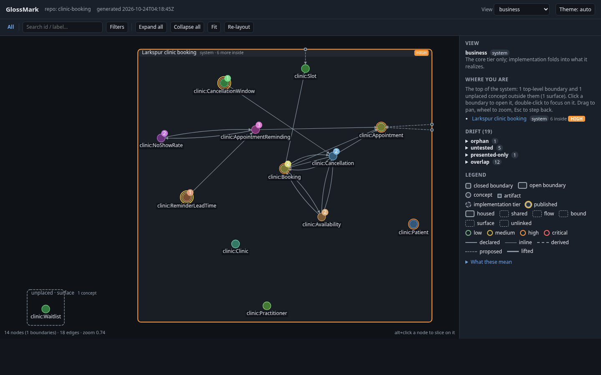
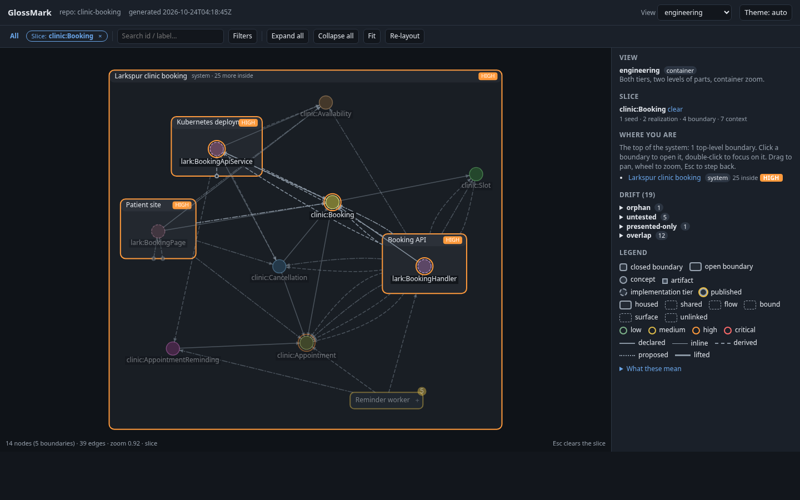
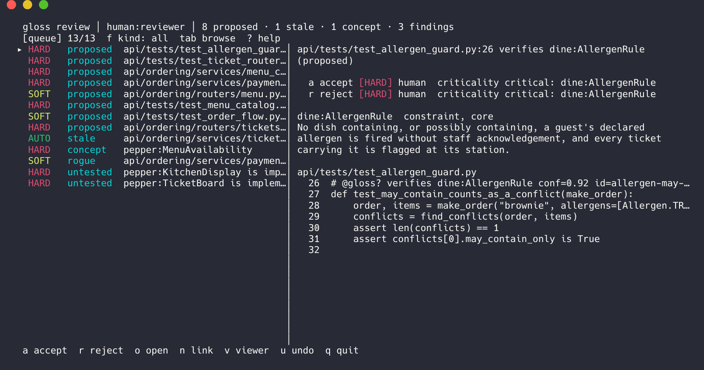

<!-- @gloss documents arch:glossmark scope=file -->
# GlossMark

**Your coding agents don't know your business rules. GlossMark teaches them, checks them on every PR, and routes risky changes to the right human, starting from your existing repo in ten minutes.**

It is for teams that recognise one of these:

- **Agents write code that ignores the domain.** The auto-approval limit, the filing window, the rule that a refund needs two signatures: they live in people's heads and in scattered comments, so an agent (or a new hire) changes them without knowing they matter.
- **Reviewers cannot tell which PRs matter.** A 40-file PR that renames a helper and a 2-line PR that moves money without a human look the same in the queue.
- **Audits ask "where is this rule enforced, and who approved changing it?"** and the answer is a search through git log.
- **Architecture docs drift.** The diagram says the billing service only reads customers; the code has been writing them for a year.

GlossMark fixes these with one comment line per piece of code naming the rule or concept it serves, a short vocabulary file the business can read, and a check on every pull request that compares the two and says who needs to look.

## Sixty seconds: a business rule that cannot change quietly

From the [claims-events](https://github.com/McKalvan/glossmark-examples/tree/main/showcase/claims-events) showcase, an insurance claims pipeline. Claims up to 5000 EUR are approved without an adjuster. The code:

```python
# services/assessment/assessment/settings.py
# @gloss implements .AutoApprovalRule conf=0.9      <- one comment: this constant IS the rule
AUTO_APPROVE_LIMIT_EUR = 5_000
```

The vocabulary entry binds the rule to that line and marks it as something the business sees (entry trimmed):

```yaml
# ontology/tide.gloss.yaml
AutoApprovalRule:
  kind: constraint
  published: { as: claim:AutoApprovalLimit }   # visible to the business under this name
  value: "5000 EUR"
  value-from: { path: services/assessment/assessment/settings.py, symbol: AUTO_APPROVE_LIMIT_EUR }
```

Now an agent, with the best intentions, raises the limit to `7_500`. Nothing else changes. The next `gloss drift` says:

```
$ gloss drift
≠ Published values drifted (the bound code changed, the value did not)
  → Update value: in the ontology to match the code, or confirm the code with gloss accept --value.
  tide:AutoApprovalRule publishes "5000 EUR", bound to services/assessment/assessment/settings.py:9, which changed
  from "AUTO_APPROVE_LIMIT_EUR = 5_000" to "AUTO_APPROVE_LIMIT_EUR = 7_500"; update value: in the ontology, or
  confirm the line as is with gloss accept --value --force tide:AutoApprovalRule
```

and the pull-request check, `gloss diff`, fails the PR until a person decides, naming why and how important it is:

```
$ gloss diff --base origin/main
Ontology impact — claims-events   base origin/main   gate HARD   criticality high
≠ published value of tide:AutoApprovalRule drifted: services/assessment/assessment/settings.py:9 changed from
  "AUTO_APPROVE_LIMIT_EUR = 5_000" to "AUTO_APPROVE_LIMIT_EUR = 7_500" while value: stays 5000 EUR
  [HIGH, HARD: published value drifted: the bound code changed and value: did not]
Criticality touched: tide:AutoApprovalRule high (via claim:AutoApprovalLimit)
```

The GitHub Action posts the same as a PR comment, with the recent history of the rule. Updating `value:` to `7500 EUR` in the vocabulary clears the drift, and that edit is itself HARD, because the business-facing definition changed. Either way the rule change is a recorded decision by a named person, not a diff that slipped through. `gloss history claim:AutoApprovalLimit` later answers the auditor.

The same check catches the other three problems: a service that starts writing data its declaration says it only reads (the architecture doc is now the declaration, and it fails CI when the code disagrees), a PR that touches a concept marked `criticality: high` (the comment says "a reviewer who owns this area should see the change"), and an agent working in a directory where it is told at session start which concepts it may touch and which need a human.

## How it works, in plain words

1. **A comment line in the code.** `@gloss implements claim:AutoApprovalLimit` (or `produces`, `verifies`, `publishes`, ...) in whatever comment syntax the file uses: Python, Go, TypeScript, Kotlin, SQL, Terraform, Kubernetes YAML, protobuf, GitHub Actions, Markdown, AGENTS.md, 18 file types in all. An agent writes `@gloss?` instead, which means "I think so, a human confirms".
2. **A vocabulary file the business can read.** `ontology/*.gloss.yaml` lists the concepts (`Claim`, `AutoApprovalLimit`, `FraudScreening`), one line of definition each, who owns them, how critical they are. Engineering keeps a second list of its mechanisms (the consumer, the pipeline, the threshold constant) that each point at the business concept they stand for.
3. **A declaration per service or directory.** A small `.gloss.yaml` says what that part of the system does: which concepts it realizes, what data it produces and consumes, which events it publishes. This is the architecture doc, in a form that can be checked.
4. **A check that compares the three.** `gloss build` joins them into one graph file committed to the repo; `gloss drift` lists every disagreement (code does what the declaration does not allow, declaration promises what no code does, a rule's value changed, a concept nothing tests); `gloss diff` classifies each change in a PR as AUTO (no review), SOFT (a glance) or HARD (a named person decides) and posts the result.
5. **Agents get the context before they write.** A session-start hook briefs the agent on the directory it is in; an MCP server answers "which concept is this file about?", "what would this change touch?" and "may I link to this?" with the gate answer before the code exists.

Nothing runs at runtime; GlossMark reads comments and YAML and writes a graph file. No annotations in a framework, no new language, no server.

## Install

```sh
curl -fsSL https://raw.githubusercontent.com/mckalvan/glossmark/main/install.sh | sh -s -- v0.3.0   # Linux/macOS binary into ~/.local/bin
go install github.com/mckalvan/glossmark/cmd/gloss@v0.3.0                                          # with a Go toolchain
```

Binaries for Linux, macOS and Windows are attached to each [release](https://github.com/mckalvan/glossmark/releases); the script verifies the sha256. In CI, `uses: mckalvan/glossmark@v0.3.0` runs the same binary and posts the PR comment ([`action.yml`](action.yml)). Versions are pinned as described in [docs/VERSIONING.md](docs/VERSIONING.md).

## Try it on an example, then on your repo

```sh
git clone https://github.com/McKalvan/glossmark-examples && cd glossmark-examples/showcase/claims-events
gloss check       # lint the comment lines and the YAML: 0 errors, 1 warning
gloss drift       # the disagreements between code and declarations, one group per kind, with what to do
gloss review      # the queue of decisions, each tagged AUTO/SOFT/HARD with who may take it
gloss view        # .glossmark/viewer.html: services as boxes, click a concept for its code, tests and findings
sed -i 's/= 5_000/= 7_500/' services/assessment/assessment/settings.py && gloss build -q && gloss drift   # the demo above
```

On your own repository, in roughly ten minutes:

```sh
gloss init --dry-run           # the plan: a declaration per deployable directory, CI job, agent hook; writes nothing
gloss init                     # write it and build the first graph
gloss suggest --concepts       # draft a first vocabulary from the names in the code (or let an agent interview you: gloss hook install --skill)
gloss suggest                  # propose @gloss? comment lines for the code; accept them in gloss review
gloss check && gloss build && gloss drift
```

The [Quickstart](docs/QUICKSTART.md) walks every step. It is as easy to leave as to try: markers are comments, `gloss strip` removes every one of them with the tool's own files after a final export, and [docs/LEAVING.md](docs/LEAVING.md) says what stays and what goes. The [showcase](https://github.com/McKalvan/glossmark-examples) has five realistic adoptions to copy from: a monorepo, three repositories sharing one vocabulary, an event-driven system, an agent-heavy repository and a brownfield legacy stack.

## What it looks like

**The map.** `gloss view` draws services as boxes and concepts as nodes. This is a clinic-booking monorepo (Next.js, Go, Python, Postgres, Terraform, Kubernetes, GitHub Actions) as a practice manager sees it: only business concepts, in the language of the domain, with the two rules engineering publishes ringed.



**The same graph for an engineer,** sliced to one feature, `clinic:Booking`: the Go handler, the page, the Kubernetes deployment, and the drift findings beside them.



**The review queue.** `gloss review` lists everything an agent proposed, every link that went stale, every unknown concept and every finding, each with the gate it needs and who may decide it. An agent clears the AUTO and SOFT items itself and leaves a recommendation on the HARD ones.



## For agents

`gloss hook install` registers a SessionStart hook for Claude Code (`--cursor` adds a Cursor rule) that briefs the agent on the directory it is working in: its boundary, the concepts it may link to, the ones that are critical, and what the uncommitted changes touch. The MCP server (`gloss mcp`) offers concept search, `concepts_for_path`, `propose_link` (which returns the gate verdict before the code is written), `propose_concept`, `impact_of`, `slice_of`, `history_of`, `drift` and the review tools. `gloss hook install --skill` adds four skills: adopting GlossMark on a repository, deriving a first vocabulary from existing code, working the review queue, and planning a feature in the vocabulary before building it. `gloss agents` prints the vocabulary snippet for AGENTS.md. See [docs/QUICKSTART.md](docs/QUICKSTART.md#agent-experience). `gloss hook install --agent claude-code|cursor|copilot` writes the ready-made integration for each agent (a Claude Code plugin, a Cursor rule, Copilot instructions, each with its MCP config) as committed files; see [docs/AGENTS.md](docs/AGENTS.md). In the editor, `gloss lsp` is a language server: completion of relations and concepts after `@gloss`, hover on a concept, `gloss check` diagnostics as you type and the accept action; the VS Code extension is under [editors/vscode](editors/vscode/README.md) and [docs/IDE.md](docs/IDE.md) covers other editors.

## Compared with

| | What it is good at | Where GlossMark differs |
| --- | --- | --- |
| **[Structurizr](https://structurizr.com/), [LikeC4](https://likec4.dev/)** | Architecture-as-code: write a C4 model in a DSL and render consistent diagrams from it. | The model is written beside the code, not derived from it, so nothing fails when they disagree. GlossMark's declarations are compared with what the code says in comments on every PR, and its views are rendered from that comparison. It draws less well than either; use them for the diagrams and GlossMark for the check, or export the graph. |
| **[ArchUnit](https://www.archunit.org/), [dependency-cruiser](https://github.com/sverweij/dependency-cruiser)** (also import-linter, Nx boundaries) | Enforce layering and dependency rules from one language's import graph, fast and with no annotation. | They stop at the import graph of one language. A business rule spans a Kotlin service, a Python consumer, a Kafka topic definition, a Kubernetes manifest and a runbook; a comment is the one thing all of those have. GlossMark also names the rule ("auto-approval limit"), who owns it and how critical it is, which an import rule cannot. Keep both: they check structure, GlossMark checks meaning. |
| **[Backstage](https://backstage.io/) software catalog** | An inventory of services, owners and APIs, one `catalog-info.yaml` per component, with a portal. | Backstage describes components; GlossMark describes what the code inside them means and checks it against the code line by line. GlossMark has no portal and no plugin ecosystem. Its per-directory declaration is the natural place to point a Backstage entity at. |
| **[LinkML](https://linkml.io/), OWL / RDF** | Rigorous schema and ontology languages with reasoners, validators and a huge tooling ecosystem. | GlossMark's vocabulary files are deliberately small YAML (a concept, a kind, a definition, a few relations) that a product owner can edit in a PR, and its graph exports to LinkML ([`schemas/graph.linkml.yaml`](schemas/graph.linkml.yaml)), SQLite and PROV-O (`gloss export`). It has no reasoner and does not want one; the comparison with the code and the PR gate are the point. If you already run an OWL ontology, GlossMark is the layer that ties it to the code. |
| **A README or an agent's summary of the codebase** | Cheap, always available, regenerated on demand. | Nobody reviews it, two runs disagree, and nothing in it goes stale on purpose. A GlossMark concept has an owner, a review trail, a `proposed` state until someone accepts it, and a `planned` state with a deadline that turns a concept nobody built into a finding. |

## The vocabulary

The terms the tool's output uses, in one line each. The full definitions are in the [glossary](docs/GLOSSARY.md).

- **Marker.** The `@gloss <relation> <concept>` comment line. `@gloss?` is a proposal an agent or `gloss suggest` wrote, with a `conf=`; `scope=file` links the whole file. [Grammar](docs/GRAMMAR.md), [when to mark](docs/MARKING.md).
- **Concept.** One entry in a vocabulary file: a thing, process, event, rule or resource with a name, a definition, an owner and a `criticality`. [File formats](docs/FILE-FORMATS.md).
- **Tier.** Which of the two vocabularies a concept belongs to. The **core** tier is the business's words (`claim:AutoApprovalLimit`); the **implementation** tier is engineering's mechanisms (`tide:AutoApprovalRule`). Each implementation concept **realizes** a core concept, or is marked `internal`. [Glossary: tiers](docs/GLOSSARY.md#tiers).
- **Published.** An implementation concept the business is allowed to see, under a core name, often with a `value:` bound to a line of code. It is the only link between the tiers and the only thing another repository may import; changing it is HARD. [Governance](docs/GOVERNANCE.md).
- **Boundary and manifest.** A directory with a `.gloss.yaml` is a boundary (a service, a package, a deployment); the file is its manifest, declaring what it realizes, produces, consumes, publishes and holds, and what code under it may link to.
- **Rollup.** The rules that derive what a boundary does from the markers under it (code implementing a mechanism means the boundary realizes what that mechanism stands for), so it can be compared with the manifest. The difference is **drift**. [Graph](docs/GRAPH.md).
- **Lift.** Summarising several related concepts as their common parent (`{MotorClaim, FloodClaim}` reads `Claim`) in views and in drift findings, so a report stays readable. [ADR 0011](docs/adr/0011-range-lcs-summary.md).
- **Gate.** The review level `gloss diff` assigns a change: **AUTO** needs no review, **SOFT** a reviewer's glance, **HARD** a decision by a named person. What makes a change HARD is policy: a published concept, a constraint, a critical area, an agent acting outside its remit. [Governance](docs/GOVERNANCE.md).
- **Ledger.** `.glossmark/ledger.jsonl`, the committed review trail: who proposed, accepted, rejected or re-confirmed each link, and when. [Glossary: review states](docs/GLOSSARY.md#review-states).
- **View.** A projection of the graph by tier and zoom (`ontology/views.yaml`), rendered by `gloss view`; a PR's impact is "which views changed".

Why the vocabulary is written before the code rather than summarised from it afterwards is [ADR 0034](docs/adr/0034-ontology-first-increments.md); the one-paragraph design is in [docs/REPOSITORY.md](docs/REPOSITORY.md).

## More

- [docs/REPOSITORY.md](docs/REPOSITORY.md): what is in this repository, GlossMark applied to itself (this tree is its own first user and CI holds it to the strictest gate), versions and roadmap status.
- Docs: [Quickstart](docs/QUICKSTART.md) · [Trying it safely, leaving](docs/LEAVING.md) · [When to mark](docs/MARKING.md) · [Glossary](docs/GLOSSARY.md) · [Editor support](docs/IDE.md) · [Advanced](docs/ADVANCED.md) · [Grammar](docs/GRAMMAR.md) · [File formats](docs/FILE-FORMATS.md) · [Graph](docs/GRAPH.md) · [Governance](docs/GOVERNANCE.md) · [Versioning](docs/VERSIONING.md) · [Plan](docs/PLAN.md) · [Benchmark](docs/BENCHMARK.md) (method and harness; results not yet collected) · [ADRs](docs/adr/)
- [`examples/library`](examples/library/README.md): the worked example in this repository, two repositories sharing one vocabulary (`gloss landscape circulation holds-worker` shows the cross-repository drift).
- [glossmark-examples](https://github.com/McKalvan/glossmark-examples): the showcase behind the screenshots, and a lab that turns rough edges into issues.
